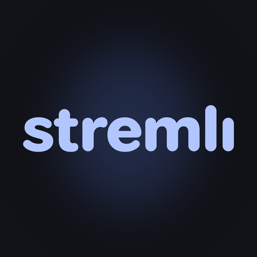
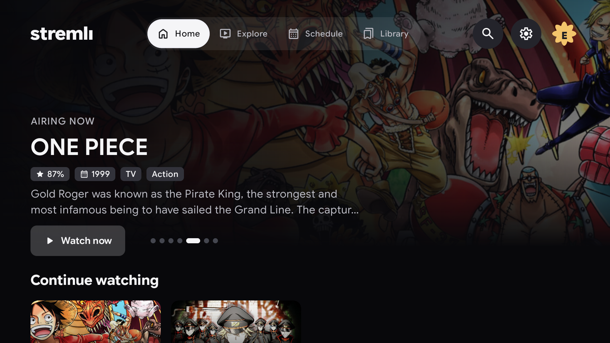
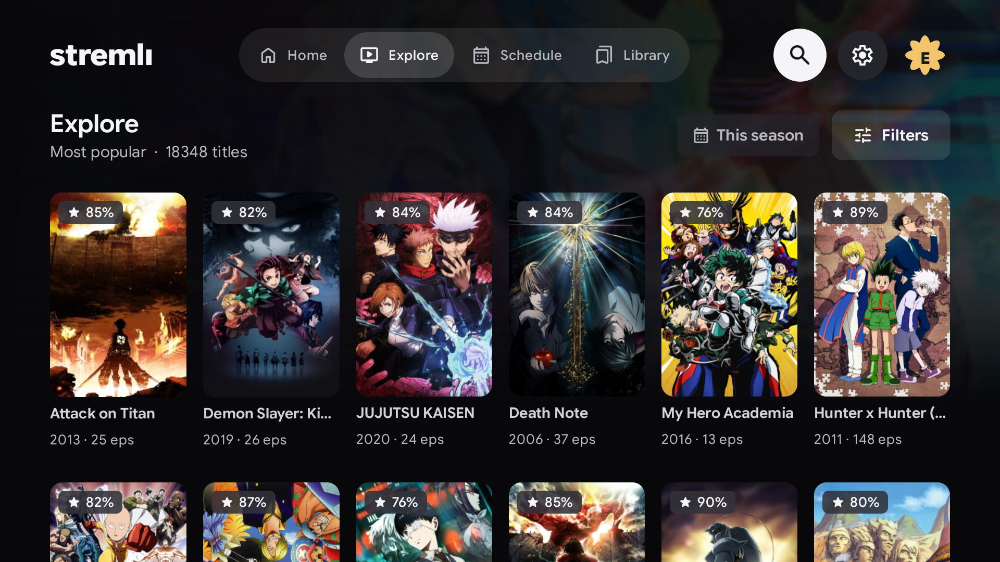
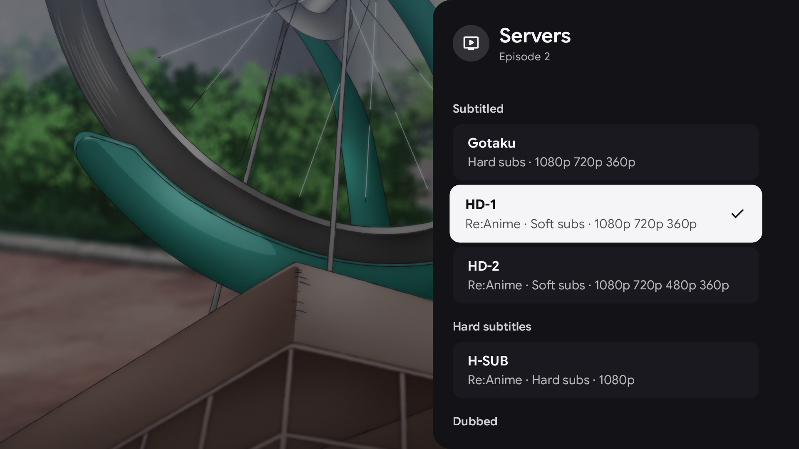
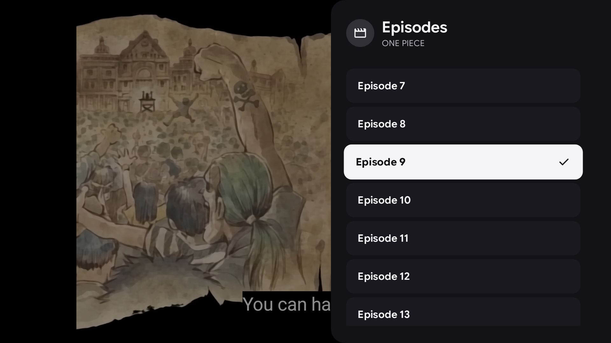

# Stremli

### The anime app built for your Fire TV Stick

 

&nbsp;

  

<a href="#made-for-fire-sticks"><b>Made for Fire Sticks</b></a> ·
<a href="#get-it"><b>Get it</b></a> ·
<a href="#screenshots"><b>Screenshots</b></a> ·
<a href="#features"><b>Features</b></a> ·
<a href="#help-make-stremli-better"><b>Contribute</b></a>

  

Most streaming apps are made for phones and stretched onto your TV. Stremli is the opposite: it was designed from the first line of code for the **Amazon Fire TV Stick**, and every screen, every menu and every byte of memory is tuned for it. Even on an older 1 GB Fire Stick it stays quick and smooth, where other apps stutter and crash.

Browse thousands of series and films, follow what's airing, keep your lists in sync, and watch from the couch with nothing but your remote. It's free, with no ads and no analytics.

## Made for Fire Sticks

- **Runs great on 1 GB sticks.** Stremli measures your stick and sizes itself to fit, so it stays smooth on the cheapest models and uses the extra room on a Fire TV Stick 4K.
- **Tiny and light.** The whole app is about 4 MB, so it won't eat the limited storage on your stick.
- **Nothing wasted while you browse.** Screens stay still when you do, which keeps your stick cool and responsive.
- **Made for the Fire TV remote.** Every feature works with the D-pad. There's nothing to tap, no mouse and no keyboard hunting.
- **Works with Alexa.** Say "Alexa, pause" or "Alexa, next" and playback follows.
- **Plays nicely with Fire OS.** Stremli pauses if your TV disconnects, and frees up memory the moment you leave it.
- **Updates itself.** Install it once. There's no sideloading again for every new version.

Stremli also runs on other Android TV devices, but Fire Sticks come first.

## Get it

**[Download the latest version](https://github.com/stremli/stremli/releases/latest/download/stremli.apk)** or see all versions on the [Releases page](https://github.com/stremli/stremli/releases/latest).

On your Fire TV Stick:

1. Install the free **Downloader** app from the Amazon Appstore.
2. Go to **Settings → My Fire TV → Developer options** and allow Downloader to install unknown apps.
3. Open Downloader and enter `https://github.com/stremli/stremli/releases/latest/download/stremli.apk`.
4. Choose **Install**, then open Stremli.

On other Android TV devices, open the same link in a browser or copy the APK over and install it with a file manager. Stremli needs Android 7.1 or newer.

After that, Stremli updates itself. It checks once a day and asks before installing anything.

## Screenshots

| Explore | Choosing a server |
|---|---|
|  |  |

| Episodes in the player | Home |
|---|---|
|  |  |

## Features

### Browse and discover

- **Home** with a rotating banner, Continue watching, new episodes, what's airing now, popular series and what's coming up. Home refreshes itself when you open it.
- **Explore** every series and film, with filters for type, season, year, genre and status.
- **Search** with suggestions, past searches and series or film filters.
- **Title pages** with the synopsis, seasons and related titles, and an episode list that stays easy to use on shows with over a thousand episodes.
- **Portrait or landscape cards**, whichever you prefer.

### Schedule

- See what's airing by week or by month.
- Show everything, or just the shows on your lists.
- Pick a day on the calendar to see what airs that day.

### Watching

- **Press Play and it starts.** Your preferred source and version are used every time, and if they aren't available the next best option plays and tells you.
- **Everything on the right.** Servers, episodes, audio and subtitles, quality and speed open in one side panel, without leaving the video.
- **Choose how you watch.** Servers are grouped by subbed and dubbed, and show their subtitle type and available qualities before you pick one. Switching server carries on from the same moment, and your pick stays for the show until you close the app.
- **Skip intros, outros and recaps** with a button, or skip them automatically when exact times are known. These parts are marked on the seek bar.
- **Picks up where you left off**, with autoplay for the next episode.
- **Remote and voice friendly.** Seek with the D-pad, use media keys, and control playback with Alexa.

### Your lists and sync

- **Sign in to AniList and MyAnimeList by scanning a QR code** on the TV with your phone. No typing passwords with a remote.
- **Two-way sync.** Changes go out as you make them, and changes made elsewhere come back in.
- **Automatic progress.** Finish an episode and your list moves forward.
- **Lists that work without an account.** Use Watching, Plan to watch, Completed, On hold, Dropped and Rewatching, or make your own.
- **Move titles around** by holding OK on any poster, and view several lists at once.

### Profiles

- Everyone gets their own profile, with their own lists, history, sign-ins and settings.
- Protect a profile with a PIN.
- Adult titles stay off unless a profile turns them on.

### Settings

- **Playback:** preferred source and version, speed, skip step, resume, autoplay and how intros, outros and recaps are handled.
- **Lists and sync:** automatic list updates and how often to check for changes.
- **Home and Schedule:** choose which rows appear, the banner, and what opens first.
- **This TV:** updates, the video buffer with advice for your stick's memory, and storage clean-up.

## Help make Stremli better

Stremli is open source, and it gets better with every person who pitches in.

- **Found a bug?** [Open an issue](https://github.com/stremli/stremli/issues/new) and tell us your device, what you did and what happened.
- **Have an idea?** [Suggest a feature](https://github.com/stremli/stremli/issues/new). Small ideas are welcome too.
- **Know Kotlin or Jetpack Compose?** Pull requests are very welcome, from typo fixes to new features. If it's a big change, open an issue first so we can talk it through.

To build it, open this folder in Android Studio with JDK 17 or newer, or run `./gradlew assembleDebug`.

Stremli is released under the [MIT License](LICENSE). Licences for the fonts, icons and other third-party work are in `app/src/main/assets`.
